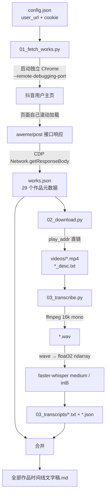

# 架构与数据流

本文解释「为什么是这样」，具体命令见 [README.md](../README.md)，排障见
[TROUBLESHOOTING.md](TROUBLESHOOTING.md)。

## 1. 总体流程



## 2. 模块职责

| 文件 | 职责 | 不负责 |
|---|---|---|
| `lib.py` | 配置合并（文件 < 环境变量 < 默认值）、路径推导、UTC+8 时间换算、Cookie 解析、Chrome/ffmpeg 定位、进度日志 | 任何网络请求 |
| `01_fetch_works.py` | 启动独立 Chrome、注入 Cookie、监听接口响应、去重汇总作品 | 下载媒体、转写 |
| `02_download.py` | 按发布时间命名、直链下载 mp4、落盘文案、跳过已有文件 | 翻页、解析接口 |
| `03_transcribe.py` | 音频提取、批量转写、断点续跑、按时间线合并 Markdown | 抓取、下载 |
| `run_all.py` | 串行调用三步，失败即停 | 重试、状态机 |
| `selftest.py` | 离线自检，供 CI 与本地验证 | 联网、启动浏览器 |
| `publish_github.py` | 可选的仓库创建与推送 | 日常运行 |

## 3. 为什么用 CDP 而不是直接调接口

抖音网页端 `aweme/v1/web/aweme/post/` 请求带签名参数。第三方 CLI 复刻签名后，
**带 `max_cursor` 的第二页常被风控返回空壳** `{"status_code":0}`（无 `aweme_list`），
于是 `has_more=1` 却拿不到后续数据，最终只得到 20 条旧片段。

本项目的做法是「不自己发请求」：

1. 启动一个带独立 `--user-data-dir` 与 `--remote-debugging-port` 的 Chrome；
2. 通过 `Network.setCookies` 注入使用者提供的 Cookie；
3. `Page.reload` 后定时执行 `window.scrollTo(0, document.body.scrollHeight)`；
4. 页面自己发起分页请求（签名由页面生成），我们只监听 `Network.responseReceived`
   并用 `Network.getResponseBody` 读取**浏览器已经收到**的响应体；
5. 按 `aweme_id` 去重汇总。

实测两页 18 + 11 = 29 条，与主页显示数量一致。副作用是必须准备好有效 Cookie，
且页面出现验证码时抓不到数据——这属于预期行为，脚本会明确报错而不是静默返回部分结果。

## 4. 数据契约

### `workspace/works.json`

```jsonc
{
  "sec_uid": "MS4w...",
  "fetched_at": "2026-11-07 21:30:00",
  "pages": 2,
  "total": 29,
  "videos": 23,
  "image_only": 6,
  "works": [
    {
      "aweme_id": "7705004629935548584",
      "create_time": 1793939587,          // Unix 秒，UTC 基准
      "time_str": "2026-11-06 18:33",
      "desc": "羊洋阳",
      "play_urls": ["https://.../video.mp4"],
      "is_video": true,
      "aweme_type": 4
    }
  ]
}
```

`is_video` 判定：`video.duration > 0` 且无 `images` 且首个播放地址不是 `.mp3`。
`aweme_type` 68/163、`duration=0` 的作品是图文/配乐，没有口播音频。

### 文件命名

```
YYYYMMDD_HHMMSS_<aweme_id>_video.mp4
YYYYMMDD_HHMMSS_<aweme_id>_video.wav
YYYYMMDD_HHMMSS_<aweme_id>_video.txt      # 03_transcripts/
YYYYMMDD_HHMMSS_<aweme_id>_video.json     # 分段时间戳
YYYYMMDD_HHMMSS_<aweme_id>_desc.txt
```

前缀由 `create_time` 显式按 UTC+8 生成，**它本身就是排序键**。同一 stem 贯穿
下载、音频、转写、合并四个阶段，因此断点续跑只需判断目标文件是否存在。

## 5. 转写链路的两个兼容决策

**不把媒体文件路径交给 Whisper。** `faster-whisper` 内部用 `av` 解码，而新版 `av`
移除了 `av.open(metadata_errors=...)` 参数，会直接抛错。本项目改为：

```text
mp4 --ffmpeg--> 16 kHz / mono / pcm_s16le wav
    --wave.readframes--> int16 ndarray / 32768.0 --> float32 ndarray
    --WhisperModel.transcribe(ndarray)-->
```

**参数放在正确的位置。** `WhisperModel(...)` 只接 `device` / `compute_type`；
`language`、`vad_filter`、`condition_on_previous_text` 属于 `transcribe()`，
传进构造函数会透传给 ctranslate2 并抛 `TypeError`。

## 6. 时间换算

| 来源 | 可信度 | 用法 |
|---|---|---|
| 接口原始 `create_time`（Unix 秒） | ✅ 唯一权威 | `datetime.fromtimestamp(ts, timezone(+8))` |
| `aweme_id >> 32` | ⚠️ 差 1~2 秒 | 仅作兜底，不用于文件名 |
| 第三方库格式化后的 `createTime` | ❌ 可能额外 +8 小时 | 不采信 |
| 文件系统 mtime | ❌ 是下载时间 | 仅在无前缀时兜底排序 |

## 7. 失败与恢复策略

- 任何阶段失败：**只记录 `progress.log`，不自动重试**（避免触发平台风控）。
- 已存在且大小合理的 mp4 / txt 自动跳过，重跑即续跑。
- 播放直链有时效；过期就重跑 `01` 刷新 `works.json`，再跑 `02`。
- 独立 Chrome 崩溃 / 端口占用：`finally` 中只 `terminate()` 自己启动的进程；
  端口被占用时换 `cdp_port` 即可。

## 8. 扩展点

| 想做的事 | 改哪里 |
|---|---|
| 换转写模型 / 语言 | `config.json` 的 `model` / `model_path`，`03_transcribe.py` 的 `language` |
| 换输出格式（HTML / SRT / JSONL） | `03_transcribe.py` 的合并段落 |
| 增加封面 / 音乐下载 | `02_download.py`，`works.json` 里补字段 |
| 增加代理或自定义 Chrome 参数 | `01_fetch_works.py` 的 `args` 列表 |
| 接入其他平台 | 新增 `01` 的同构实现，保持 `works.json` 契约不变 |

> 请勿把扩展方向用于绕过风控、批量并发抓取或获取非公开内容，见 [DISCLAIMER](../DISCLAIMER.md)。
